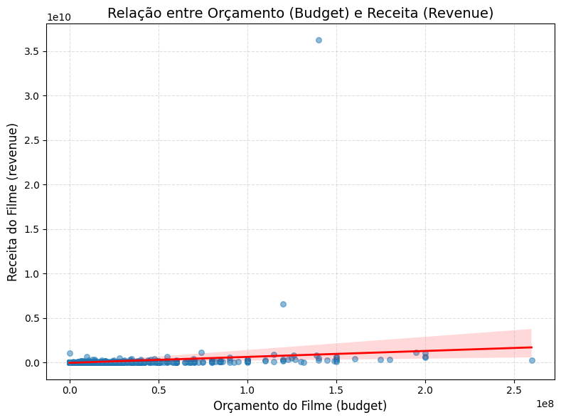
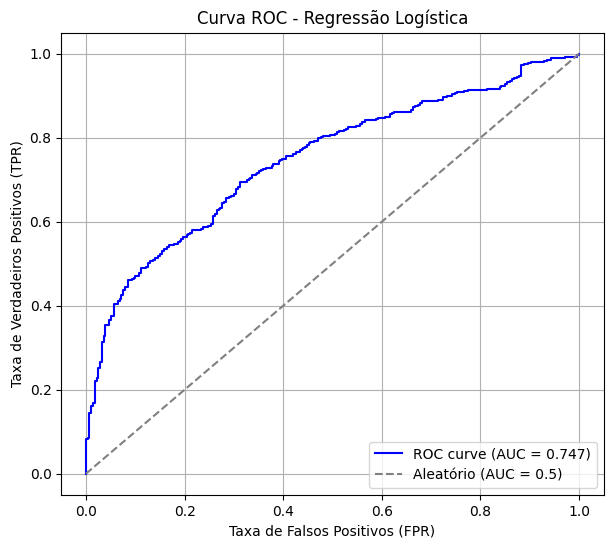
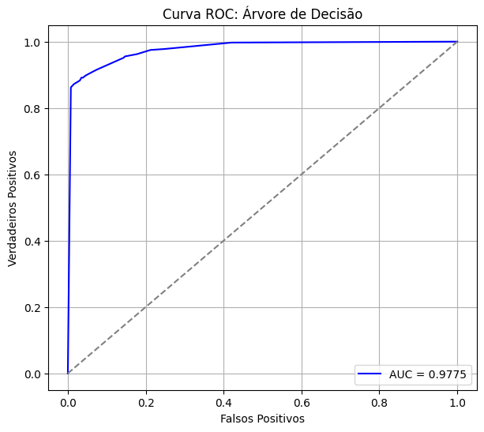
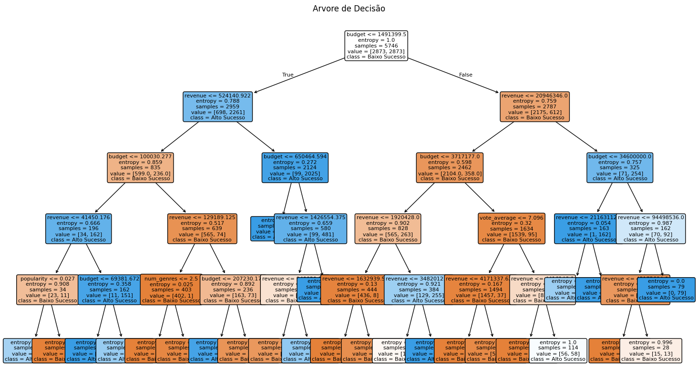
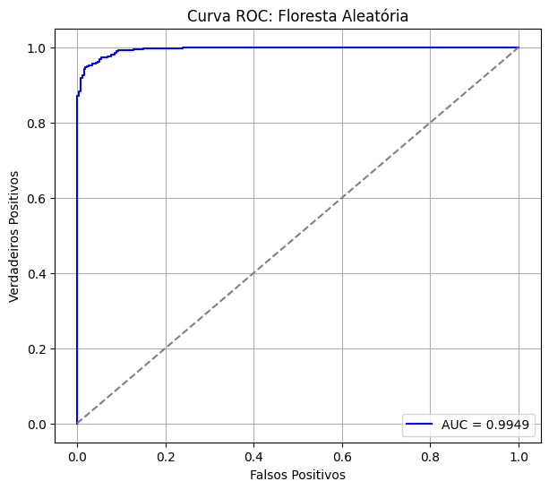
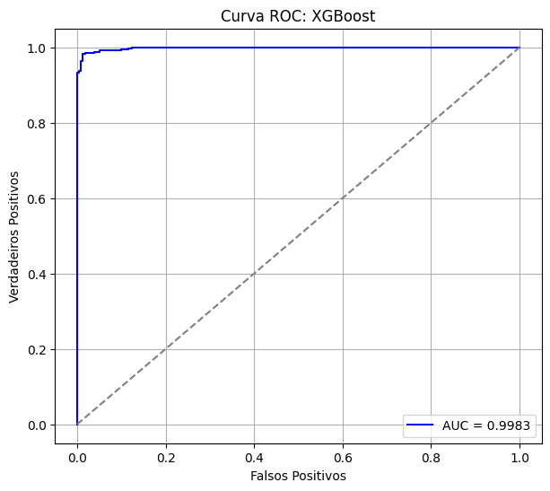
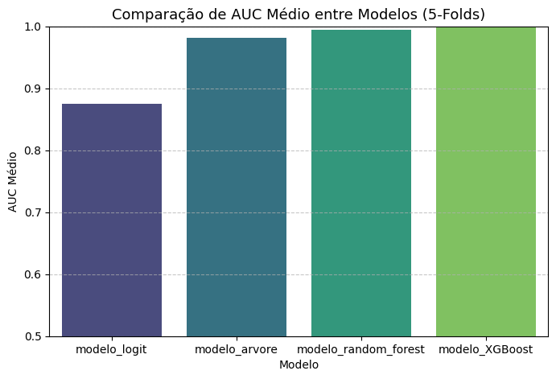
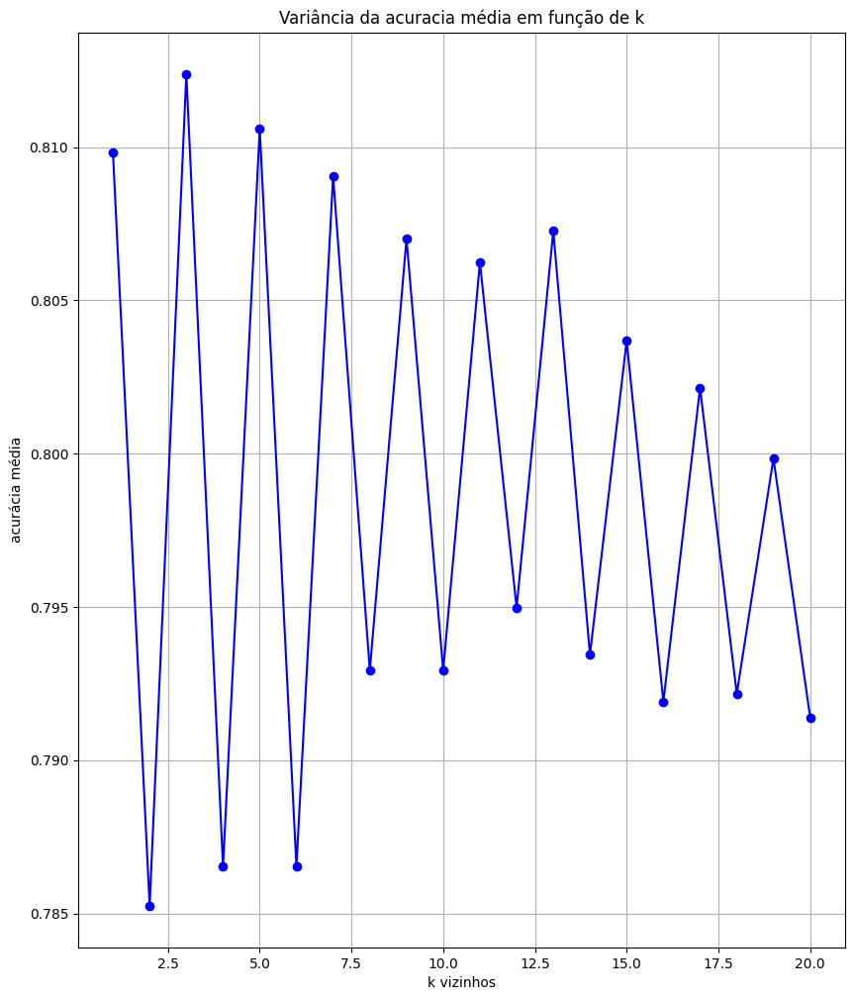
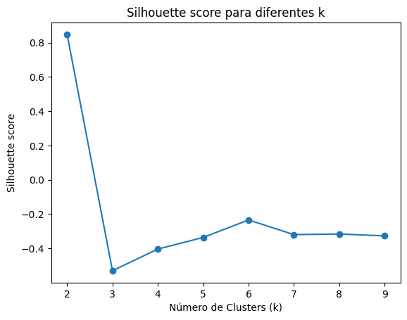
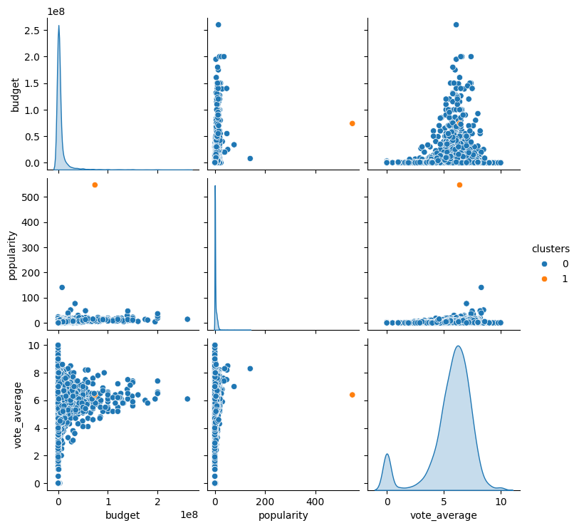

# Relatório dos modelos

## Ajuste de dados

No ajuste de dados, fizemos o input da coluna `budget` por Florestas Aleatórias com k-fold de 10 folds e utilizamos a métrica MAE para avaliação do modelo. Inicialmente com relação ao MAE médio dos folds, o modelo teve desempenho ruim ao fazer previsões errando na faixa dos __100 milhôes__ além disso apresentou-se instável devido ao alto desvio padrão dos MAEs. Assim, aplicamos transformação logarítmica na coluna alvo `budget` já que os altos erros poderiam vir de outliers que são bem comuns nessas colunas. 

Com a transformação logarítmica, o modelo tem uma melhora significativa pois na escala original o erro logarítmico de `1.32` equivale a errar por um fator de `2.74`, ou seja, em média o modelo prevê valores `2.74` vezes acima ou abaixo do valor real o que é mais razoavel do que errar por centenas de milhões ou bilhões como anteriormente sem a transformação log. Além disso, o __desvio padrão__ do `log_mae` ser aproximadamente `0.21` nos indica uma consistência bem maior entre os `folds` e o modelo aprendeu padrões mais coerentes com a realidade dos dados.

## Regressão Linear

Nesse script inputamos a coluna `revenue` com regressão linear mas anteriormente a isso fizemos uma avaliação do modelo por MSE manual, MSE dado pelo `scikit learning` e `R2`.

Primeiramente, notamos que o `MSE manual` e com `sklearn.metrics.mean_squared_error` tem os mesmos valores para a coluna `revenue` e que ambos são altos com valor aproximado de `9.8 x 10^15`. Isso se dá por conta que tipicamente essa coluna tem uma grande variabilidade nos dados com receitas variando de milhôes a bilhões e da existencia outlies, então é natural que o `MSE` seja grande quando os valores são dessa magnitude. Em termos de variabilidade explicada, o `r2 médio` nos mostra que o modelo explica `38%` da variabilidade da receita dos filmes, ou seja, `38%` da variação total observada na variável dependente `y`, pode ser explicada pelas variáveis independentes `X` usadas no modelo. Esse valor de `38%` indica que as features `X` explicam pouco da variação de `revenue`. Além disso, podemos perceber que há um alto desvio padrão na média dos erros (__MSE__) indicando que o desempenho do modelo varia muito de um `fold` para outro. Isso mostra que o modelo atual é instável.

Aplicamos transformação logarítmica para melhorar a performace do modelo e vemos que a média manual e a do `sklearn` tem os mesmos valores em escala logarítmica. O erro do MSE é aproximadamente `7.33` e isso nos diz que, em média, o modelo faz previsões de `log(revenue)` com erro de `7.33` unidade logarítmicas e convertendo aproximadamente para a escala real dos valores em `revenue`, temos um erro de `e^(7.33)` que é aproximadamente `1525`, ou seja, o modelo costuma errar o valores previsto em `revenue` por um valor de `1525` vezes, o que é um valor alto mas menor do que os quartilhões de diferença de antes. A média de `r^2` aproximadamente `0.23` em escala logarítmica nos diz que o modelo explica `23%` da variação da receita por meio das `features` isso é baixo mas mostra que o modelo está capturando algo útil e não apenas sendo aleatório ou constante.

Para plotar o gráfico, percebemos que os valores de índices `50` e `70` estavam corrompidos e por conta deles o gráfico de disperssão ficava explodindo já que eles distorcem a escala. Então removemos eles do dataset. No gráfico podemos constatar que a receita cresce conforme cresce orçamento.

## Regressão logística

No modelo de regrassão logística tivemos que prever a variável `sucesso` segundo `budget`, `popularity` e `vote_average`. A princípio, antes de fato treinar o modelo, normalizamos os dados e balanceamos as classes com oversampling SMOTE visto que os dados estavam bem desbalanceados com a classe predominante sendo a `classe 1`.

Analisando a __curva roc-auc__ do modelo percebemos que há uma discriminação moderada das classes com `AUC = 0.7474`. A medida que a __ROC__ vai para o canto superior direito do gráfico o modelo tem melhor desempenho, classificando melhor os dados.

Tetando analisar a causa do valor negativo em popularidade, plotamos a matriz que mede o grau de correlação entre essas features. Percebemos que a correlação entre elas é baixa pois a maior que existe é entre `popularity` e `budget` onde temos `0.307321`, então não temos __multicolinearidade__ nas features algo que ocorreria apenas se a correlação fosse maior do que `0.7` o que poderia ser um problema e a causa de distorcer o sinal dos coeficientes, o que não é o caso.

Então, interpretando os `coeficientes log_odds` temos que aumentando em uma unidade de `popularity` diminue a chance de `sucesso`, ou seja, a probabilidade é baixa. Aumentando a unidade de `budget` aumenta a chance de `sucesso` e por conta que `budget` tem valores extremamente altos, podem ser que tenham muito impacto na probabilidade de `sucesso`. Por fim, aumentando a unidade de `vote_average` diminue a chance de `sucesso`.

## Random Forest

Em todos os modelos dessa seção fizemos um treinamento usando grid search com cross validation para extrair a melhor estimativa de cada um. 

No primeiro modelo, treinamos uma árvore de decisão e ao treinarmos o modelo por __k-folds__ e vermos o seu desempenho, podemos perceber que o __AUC médio__ (melhor AUC) do treinamento é de aproximadamente `0.98` o que indica um bom desempenho do modelo. Além disso, quando o modelo final é treinado na divisão de treino (80%) e teste (20%), temos um AUC de `0.977` que mostra que o modelo generaliza bem para novos dados (situação real).

Analizando a arvore de decisção no primeiro nó temos entropia igual a 1 o que significa impureza máxima e as classes estam igualmente misturadas. Com a regra feita na feature `budget` temos a primeira ramificação da ávore e conforme foram feitas as regras em `revenue` e `budget` podemos notar que a maioria das entropias diminuíram, diminuindo a impureza com __nós__ mais homogêneos até que na terceira divisão conseguimos o primeiro __nó folha__ com impureza mínima.

Comparando os modelos de arvore de decisão e regressão logistica no `f1_score` vemos que o modelo de arvore de decisão tem um melhor desempenho na previsão de novos dados com `f1_score` de `0.92` e consequentemente `precisão` e `revocação` mais altas.

Agora, fazendo o ensemble de arvore de decisão que são as florestas aleatórias, podemos ver que tivemos uma melhora no modelo ensemble tanto com a média do AUC de k-folds quando o AUC do treino final cujos valores de ambos são `0.995`. Além disso, conseguimos perceber que a curva ROC está mais delocada para o canto superior esquerdo do gráfico, o que confirma o melhor desempenho.

Já o modelo XGBoost teve o melhor desempenho dos demais modelos com AUC médio dos k-folds `0.999` e AUC no treino final de `0.998`. Além disso, a curva ROC está deslocada mais ainda para o canto superior esquerdo do gráfico sem falar da velocidade de treinamento que é mais rápida do que os demais modelos.

Plotando os AUCs médios dos modelos nos k-folds a fim de comparalos, temos:

## k-Nearest Neighbors (kNN)

Após treinado o modelos de KNN para prever `sucesso`, temos que o melhor hiperparâmetro `k vizinhos` para o modelo de KNN é `k = 3`. 

No contexto de viés e variância percebemos que, para `k = 3`, há um equilíbrio entre essas duas grandezas. Logo, o modelo generaliza bem para novos dados, visto que a acurácia de teste no treinamento final do modelo é de `0.80` bem proxima do que a acurácia média de `0.8124` no cross-validation. Já para `k < 3` embora acurácia seja alta não generaliza tão bem quando para `k=3` o que significa que o modelo está se adequando muito aos dados de treinamento gerando alta variância (__overfitting__). Para `k > 3` temos uma queda de acurácia e generalização do modelo, o que significa que o modelo está suavizando e desconsiderando nuances locais, gerando um viés cada vez maior (__underfitting__).

## Naive Bayes (GaussianNB)

Após treinar o modelo para prever `sucesso`, podemos ver que o __f1_score__ do treino final nos dados de teste foi maior do que a estimativa do __gride search__ no treinamento (`0.40 > 0.325`) quando foi para buscar os melhores hiperparâmetros para o modelo. Isso indica que o medelo não está em overfitting, uma vez que a inferência em novos dados teve melhor desempenho do que a estimativa da capacidade de generalização do modelo (treinamento). Por outro lado, o modelo no teste obtendo `f1 score` de `0.40` ainda é considerado baixo e pode indicar que está tendo dificuldades em separar as classes.

Por fim, temos que tanto no cálculo manual quanto no cálculo dado pelo scikit_learn o resultado foi o mesmo de `x_prova` ter probabilidade de quase 100% de pertencer a classe `1`.

## Regressão Ridge e Lasso com validação Cruzada e Comparação de Modelos

Treinando primeiramente um modelo de regressão linear padrão para prever `revenue`, temos que o modelo apresentou um viés muito alto no k-fold dado pelo gride search com RMSE médio bastante elevado de aproximadamente __385 milhões__ tendo em vista que o valor típico em `revenue` é de __2 milhões__, o que mostra que o modelo tem baixa capacidade preditiva. Porém, no treino final dado pelo melhor modelo do grid search tivemos uma redução do RMSE para aproximadamente __205 milhões__ o que configura um viés bastante alto mas o modelo apresentou um grau de generalização dos dados, o que diz que aprendeu algo de útil. Pelo coeficiente de determinação `r2`, o modelo explica apenas aproximadamente __12%__ da variação da variavel `revenue` (variável dependente) dado pelas features (variáveis independentes), ou seja, a regressão linear não está capturando bem as relações nos dados. Com essas observações, vemos que esse modelo é muito simples para o dataset que pode ter relações não lineares entre os dados, outliers e features irrelevantes.

Na Ridge temos ainda RMSE bastante elevado embora menores do que no modelo linear padrão. Ainda assim, o modelo generaliza no treino final para os dados de teste mostrando que está aprendendo algo útil e é o que se espera de um modelo regularizado. O `r2` um pouco maior diz que com a regularização Ridge o modelo explicou melhor a variação de `y` com relação as features. Isso nos diz que o modelo coseguiu capturar melhor as relações entre as features mas ainda é um modelo simples para este dataset.

A Lasso foi o pior dos três modelos sendo pior até mesmo do que o modelo linear padrão devido a RMSE médio mais alto (aumentou o viés), `r2` menor e capacidade de gerneralização mais baixa.

Com essas observações vemos que o modelo com melhor desempenho foi o da regressão Ridge.

Com relação aos coeficientes do melhor modelo (treino final) dado pelo grid search, não tivemos coeficientes zerados em nenhum dos modelos regularizados (Ridge e Lasso) ao passo que no modelo linear, temos algumas features iguais a zero.

O __overfitting__ é quando o modelo se ajusta demais aos dados de treinamento, desempenhando bem nesses dados porém gerando baixa capacidade de generalização do modelo para novas instâncias. Nessa situação, dizemos que o modelo apenas "decorou" os dados de treinamento (alta variância). A regularização tem como objetivo diminuir a complexidade do modelo que por consequência irá dimuir a variância e, portanto o overfitting, aceitando um pouco do aumento do viés. Por meio disso, o modelo tem uma queda no desempeho do treino mas aumenta a capacidade de generalização para novos dados, que é o ideal. O processo de regularização se da através da inclusão de um novo termo na função de custo a ser minimizada no treinamento. Esse termo faz com que os parâmetros treinaveis reduzam e, em alguns casos, como na __Regressão Lasso__, são zerados, fazendo uma seleção de features. A redução dos pesos deixa o modelo mais simples e menos sensíveis a pequenas flutuações nos dados de treinamento.

## K-Means

Treinando o modelo de k-means, omo o maior silhoutte score é o número ideal de clusters, temos que para `k=2` é a situação ideal para as features de `orçamento`, `popularidade` e `avaliacao_media` com silhoutte score de aproximadamente `0.85`.

Na matriz de dispersão temos que cada ponto é um regitro (filme) e cada cor representa um cluter (azul e laranja). O cluster na cor azul nos diz que grande maioria dos filmes possuem orçamento baixo, popularidade baixa e média de votos variando de 4 a 7 representando os filmes comuns do dataset que não possuem muita fama. Já uma pequena quantidade, no cluster laranja, temos filmes exepcionais com altos orçamento e popularidade alta com grandes indícios de serem outliers pois aparecem bem afastados dos demais, exatamente como o k-means deve capturar quando existem outliers. O resultado é consistente com silhouette alto.

Fazendo uma comparação do modelo não-supervisionado __K-Means__ e supervisionado __XGBoost__, o XGBoost sabe quais são as classes e é treinado para distingui-las da melhor forma possivel. Já o K-Means tenta encontrar grupos naurais dos dados ele não sabe quais são as classes reais. Os clusters são bem separados __entre si__ mas isso não garante que correspodam às classes verdadeiras.

O XGBoost claramente soube separar melhor as classes tendo em vista que ele usa rótulos verdadeiros para aprender fronteiras de decisão ideais e com `AUC = 0.999` indica uma separação quase perfeita entre as classes reais.

Já o K-Means embora tenha produzido clusters bem definidos com bom silhouette, não tem relação direta com as classes verdadeiras, apenas encontrou padrões naturais. É possível e até comum que clusters não correspondam exatamente as classes do problema supervisionado. 